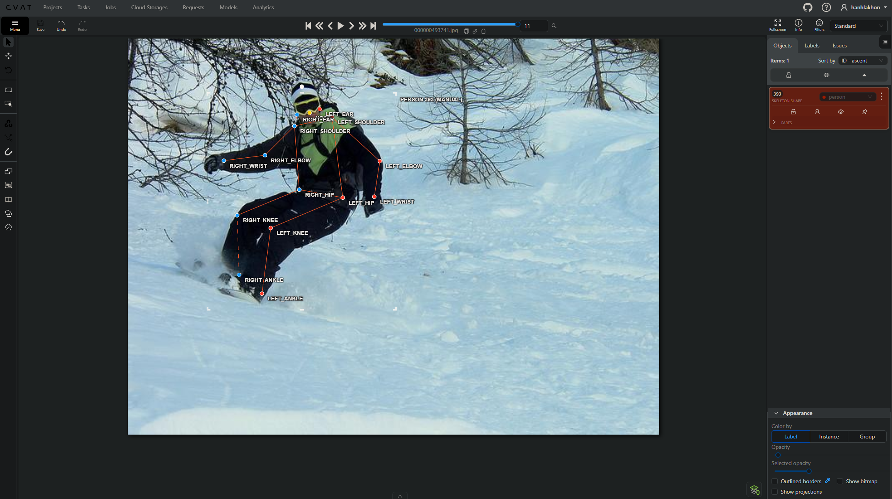
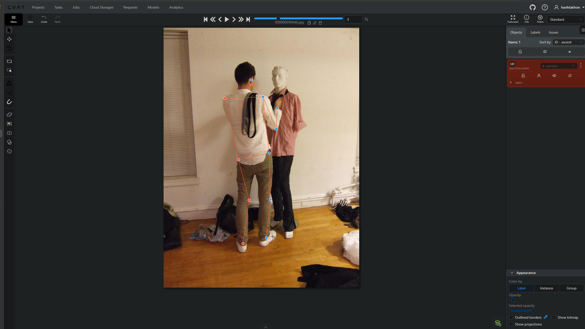
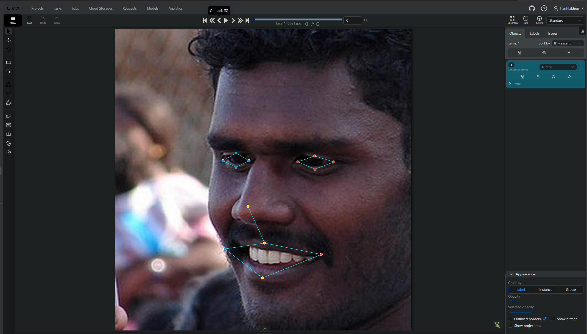
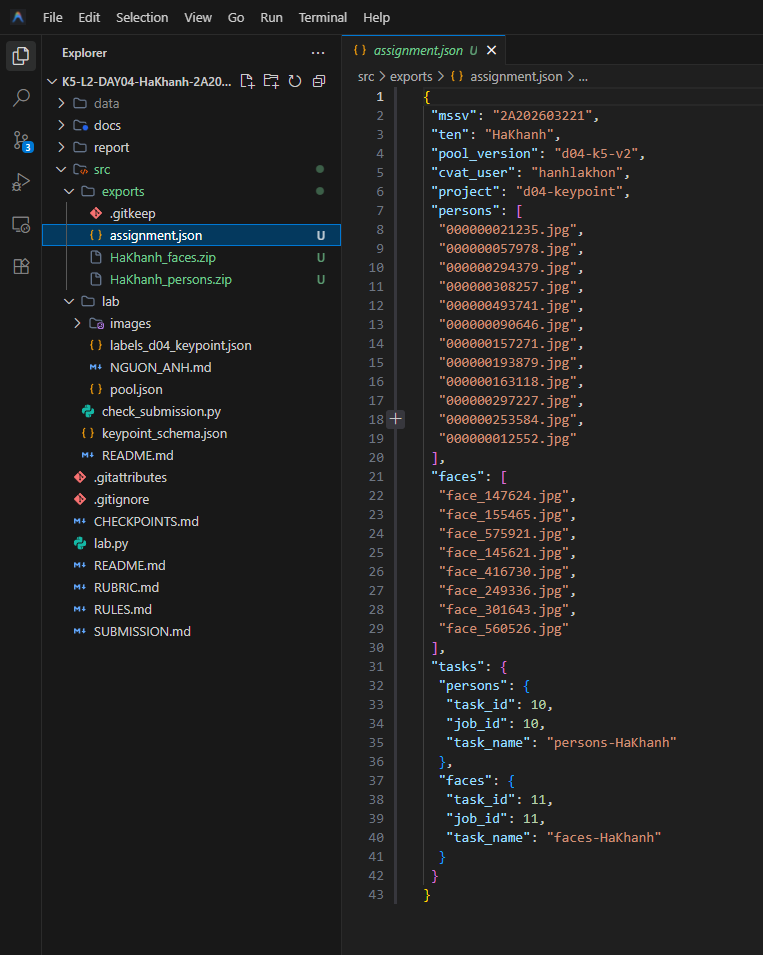

# Báo cáo cá nhân: HaKhanh-2A202603221

Dữ liệu: 12 ảnh người COCO val2017 (Lin et al., 2014) và 8 ảnh chân dung Wikimedia Commons, chỉ dùng trong lớp.

## 0. Thông tin học viên

- Họ tên: Hà Khánh (HaKhanh)
- MSSV: 2A202603221
- Email: hakhanh699669@gmail.com
- Link repository: https://github.com/Ngunhcho7654/K5-L2-DAY04-HaKhanh-2A202603221-KeypointPose
- Phiên bản CVAT (Help -> About): 2.82
- Máy: hệ điều hành Windows 11 · RAM 16 GB · chạy CVAT chế độ đầy đủ
- Bộ ảnh (`src/exports/assignment.json` do `lab.py setup` tạo): có
- Giờ bắt đầu: 21:28
- Giờ kết thúc: 00:38

## 1. Kiểm tra label (CP0)

| Label | Kiểu | Số điểm | Tên điểm đúng bảng của lab? | Đúng thứ tự? | Số cạnh |
|---|---|---:|---|---|---:|
| `person` | Skeleton | 17 | Có | Có | 19 |
| `face` | Skeleton | 13 | Có | Có | 13 |

Mẫu `person` dựng theo người quay mặt về camera (các điểm `left_*` nằm bên phải khung mẫu)? Có

Cách đổi cờ `occluded` / `outside` cho một điểm trên phiên bản CVAT này (một câu):

Rê chuột vào đúng điểm cần đổi cho đến khi điểm đó sáng lên, sau đó bấm phím `Q` để bật hoặc tắt `occluded` (`v = 1`), bấm phím `O` để bật hoặc tắt `outside` (`v = 0`), hoặc nhấp chuột phải vào điểm để chọn trên menu.

## 2. Số lượng đã gán và thời gian (CP1, CP2)

| Nhóm ảnh | Số ảnh | Số skeleton đã gán | Số người dưới 60 px (không gán) | Số poster / gương / màn hình bỏ qua | Thời gian (phút) |
|---|---:|---:|---:|---:|---:|
| `easy` | 5 | 5 | 1 | 0 | 25 |
| `occluded` | 3 | 6 | 0 | 1 | 30 |
| `back` | 2 | 4 | 1 | 0 | 18 |
| `small` | 1 | 1 | 7 | 0 | 8 |
| `crowd` | 1 | 3 | 0 | 0 | 14 |
| `faces` | 8 | 8 | Không áp dụng | 0 | 28 |

- Số ảnh người đã xong ở mốc phút 105: 9 / 10
- Thời gian thực tế (phút): CP1 95 · CP2 28 · CP3 20
- Ảnh tốn thời gian nhất là ảnh nào, vì sao?

Ảnh `000000193879.jpg` (nhóm `occluded`, 3 người trên sân quần vợt) tốn nhiều thời gian nhất (khoảng 15 phút). Vận động viên áo trắng ở tiền cảnh đang chạy vắt chéo chân và vung vợt, che khuất phần lớn trọng tài biên đứng sau và người mặc quần trắng đang cúi ở giữa sân. Người thứ ba chỉ lộ cổ tay trái cùng phần chân dưới lớp áo của người phía trước, nên tôi phải phóng to từng vùng để tách riêng các chi của từng người và quyết định điểm nào còn đủ căn cứ ước lượng (`v = 1`), điểm nào phải chuyển sang `outside` (`v = 0`).

## 3. Bảng ca khó (CP1, CP2)

Mỗi điểm bạn phân vân một dòng, nhất là phân vân giữa `v = 1` và `v = 0`, hoặc không chắc hướng người.

| Ảnh | Người / mặt | Điểm | Cờ đã chọn | Phân vân giữa | Lý do chọn |
|---|---|---|---:|---|---|
| `000000012552.jpg` | Người #1 (trọng tài áo đen) | `right_knee` | `v = 0` | `v = 1` và `v = 0` | Đầu gối phải khuất hẳn sau lưng và đùi phải của cầu thủ bắt bóng, không thấy đoạn đùi để nội suy vị trí khớp |
| `000000012552.jpg` | Người #1 (trọng tài áo đen) | `right_hip` | `v = 1` | `v = 2` và `v = 1` | Áo đen rộng và thân người phía trước che khuất một phần hông phải, nhưng xác định được vị trí từ trục lưng và hông trái |
| `000000012552.jpg` | Người #2 (cầu thủ bắt bóng) | `right_knee` | `v = 1` | `v = 1` và `v = 0` | Ống quần của trọng tài che đúng vùng đầu gối phải, nhưng thấy rõ hướng đùi và cổ chân phải đang ngồi xổm nên ước lượng được tâm khớp |
| `000000193879.jpg` | Người #1 (vận động viên quần vợt) | `right_elbow` | `v = 1` | `v = 2` và `v = 1` | Cẳng tay đưa ngang qua ngực để vung vợt làm che khuất khớp khuỷu tay phải, định vị được nhờ nối từ vai phải xuống cổ tay phải |
| `000000193879.jpg` | Người #1 (vận động viên quần vợt) | `right_knee` | `v = 1` | `v = 1` và `v = 0` | Chân phải bước chéo ra sau đùi trái nên bị bắp chân trái che, nhưng nhìn rõ ống đồng và cổ chân phải để suy ra vị trí khớp |
| `000000193879.jpg` | Người #3 (người cúi phía sau) | `right_knee` | `v = 1` | `v = 1` và `v = 0` | Ống quần trắng rộng che kín đầu gối, nhưng bàn tay đang chống ngay trên gối và thấy rõ cổ chân phải nên ước lượng được điểm gập chân |
| `000000297227.jpg` | Người #1 (cảnh sát bên trái) | `left_knee` | `v = 1` | `v = 1` và `v = 0` | Túi đồ lớn sau yên xe đạp che khuất vùng gối trái, nhưng thấy hông trái và bàn chân trái đang đạp bàn đạp nên nội suy được vị trí khớp |
| `000000308257.jpg` | Người #1 (cô gái ngồi bậc đá) | `left_wrist` | `v = 1` | `v = 1` và `v = 0` | Cổ tay trái khuất sau màn hình laptop đang mở, nhưng thấy khuỷu tay trái và hướng cẳng tay đặt vào bàn phím |
| `000000493741.jpg` | Người #1 (người trượt tuyết) | `nose`, `left_ear`, `right_ear` | `v = 1` | `v = 1` và `v = 0` | Kính bảo hộ bản to và mũ trùm che mũi và hai tai, nhưng đầu nhìn thẳng nên định vị được qua khung mặt; hai mắt bị kính phản quang che phẳng nên để `v = 0` |
| `face_301643.jpg` | Mặt #1 (đeo kính râm) | `left_eye_*`, `right_eye_inner`, `right_eye_upper`, `right_eye_lower` | `v = 1` | `v = 1` và `v = 0` | Tròng kính râm tối màu che khuất con ngươi và mí mắt, nhưng gọng kính và sống mũi rõ nên đặt được vị trí mắt sau kính theo quy ước |
| `face_560526.jpg` | Mặt #1 (đội mũ len xanh) | 8 điểm mắt (`left_eye_*`, `right_eye_*`) | `v = 0` | `v = 1` và `v = 0` | Mũ len dày kéo sụp xuống tận sống mũi che kín cả lông mày lẫn hốc mắt, không có căn cứ hình học để đoán vị trí mí mắt |

## 4. Bảng tự review (CP3)

Đi từ ảnh cuối về ảnh đầu. 5 ảnh người (ít nhất 2 ảnh `back` hoặc `crowd`) và 3 ảnh mặt. Ít nhất 8 dòng, kể cả dòng `ok`. Ghi lỗi trước, sửa sau.

Mã lỗi dùng đúng một trong: `lr_swap`, `vis_flag`, `position`, `missing`, `extra`, `ok`.

| Ảnh | Người / mặt | Điểm | Mã lỗi | Ghi chú | Đã sửa? |
|---|---|---|---|---|---|
| `000000012552.jpg` | Người #1 (trọng tài) | `left_hip`, `right_hip` | `position` | Đặt hai điểm hông hơi cao lên vùng thắt lưng quần, đã kéo xuống đúng tâm khớp hông | Có |
| `000000253584.jpg` | Người #1 (trượt ván) | Toàn bộ 17 điểm | `ok` | Đã kiểm tra hướng người và các người nhỏ dưới 60 px ở sườn đồi nền không gán | Có |
| `000000297227.jpg` | Người #1 (cảnh sát trái) | `left_shoulder`, `right_shoulder` | `lr_swap` | Người quay lưng nhưng lúc đầu quên đảo vai trái sang bên trái ảnh, đã đổi lại đúng bên | Có |
| `000000163118.jpg` | Người #1 (áo số 76) | `nose`, `left_eye`, `right_eye` | `vis_flag` | Người quay lưng hoàn toàn nhưng để sót cờ mặc định `v = 2` ở mũi và mắt, đã chuyển sang `outside` (`v = 0`) | Có |
| `000000193879.jpg` | Người #2 (trọng tài biên) | `right_knee`, `right_ankle` | `vis_flag` | Chân phải bị thân vận động viên phía trước che kín hoàn toàn, đã đổi từ `occluded` sang `outside` (`v = 0`) | Có |
| `000000090646.jpg` | Người #1 (áo trắng) | Toàn bộ 17 điểm | `ok` | Đã kiểm tra hướng người quay lưng và không gán ma-nơ-canh mặc áo hồng phía trước | Có |
| `face_560526.jpg` | Mặt #1 | 8 điểm mắt (`left_eye_*`, `right_eye_*`) | `vis_flag` | Mũ len che kín toàn bộ vùng mắt không đoán được vị trí mí, đã đổi cả 8 điểm sang `outside` (`v = 0`) | Có |
| `face_301643.jpg` | Mặt #1 | `left_eye_upper`, `left_eye_lower` | `vis_flag` | Mắt trái nằm sau tròng kính râm tối màu nhưng quên bật `occluded`, đã chuyển sang `occluded` (`v = 1`) | Có |
| `face_249336.jpg` | Mặt #1 | `right_eye_upper`, `right_eye_lower` | `position` | Điểm mí mắt phải đặt lệch ra phần lông mi dưới gọng kính cận, đã phóng to và kéo về sát mép mí | Có |

Tổng hợp số lỗi theo mã:

| `lr_swap` | `vis_flag` | `position` | `missing` | `extra` | `ok` |
|---:|---:|---:|---:|---:|---:|
| 1 | 4 | 2 | 0 | 0 | 2 |

Điểm còn phân vân giữa `v = 1` và `v = 0` (ghi cả hai lựa chọn và lý do chọn):

- Ở ảnh `000000012552.jpg` (cầu thủ bắt bóng #2, điểm `right_knee`): nếu chọn `v = 0` thì an toàn vì ống quần trọng tài đã che kín đầu gối, còn nếu chọn `v = 1` thì giữ được thông tin tư thế ngồi xổm vì cả hông phải lẫn cổ chân phải đều lộ rõ. Tôi chọn `v = 1` do khoảng cách từ hông xuống cổ chân ở tư thế gập gối rất ngắn, ba người cùng ước lượng sẽ đặt điểm rơi gần nhau.
- Ở ảnh `face_560526.jpg` (8 điểm mắt dưới mũ len xanh): nếu chọn `v = 1` thì phải đoán vị trí hai mắt qua tỷ lệ khuôn mặt từ cánh mũi trở lên, còn chọn `v = 0` thì bỏ qua toàn bộ vùng mắt bị che. Tôi chọn `v = 0` vì mũ len che phẳng từ trán xuống sống mũi, sai số vài pixel ở mí mắt sẽ làm hỏng tỷ số mở mắt khi huấn luyện.

## 5. Kiểm file xuất và kết quả tự kiểm (CP4)

Tự kiểm tay trong file JSON:

| File | Người / mặt kiểm (ảnh, thứ tự) | Số phần tử `keypoints` | Điểm `outside` ra `v = 0`, `occluded` ra `v = 1`? | `num_keypoints` khớp? |
|---|---|---:|---|---|
| `HaKhanh_persons.zip` | `000000012552.jpg`, người #1 (`id = 1`) | 51 | Có (7 điểm `v = 0`, 2 điểm `v = 1`) | Có (`num_keypoints = 10`) |
| `HaKhanh_persons.zip` | `000000493741.jpg`, người #1 (`id = 19`) | 51 | Có (2 điểm `v = 0`, 4 điểm `v = 1`) | Có (`num_keypoints = 15`) |
| `HaKhanh_faces.zip` | `face_301643.jpg`, mặt #1 (`id = 5`) | 39 | Có (0 điểm `v = 0`, 7 điểm `v = 1`) | Có (`num_keypoints = 13`) |

Sau khi xuất, CVAT ghi `occluded` thành `v = 1` và `outside` thành `v = 0`. Tọa độ của điểm `outside` trong file là `0, 0` hay tọa độ cũ? Tọa độ cũ.

Hai job đã chuyển sang completed trên CVAT? Có

Dán phần **TÓM TẮT** in ra từ `src/check_submission.py`:

```text
----- TÓM TẮT (dán vào báo cáo mục 5) -----
- File person: HaKhanh_persons.zip
  Số ảnh: 12 · số skeleton `person`: 19 · mỗi annotation 51 số
  Skeleton theo ảnh: 000000012552=3, 000000021235=1, 000000057978=1, 000000090646=1, 000000157271=2, 000000163118=2, 000000193879=3, 000000253584=1, 000000294379=1, 000000297227=2, 000000308257=1, 000000493741=1
  Cờ v: v=2 204 (63%) · v=1 31 (10%) · v=0 88 (27%)
  num_keypoints trung bình: 12.4
- File face: HaKhanh_faces.zip
  Số ảnh: 8 · số skeleton `face`: 8 · mỗi annotation 39 số
  Skeleton theo ảnh: face_145621=1, face_147624=1, face_155465=1, face_249336=1, face_301643=1, face_416730=1, face_560526=1, face_575921=1
  Cờ v: v=2 89 (86%) · v=1 7 (7%) · v=0 8 (8%)
  num_keypoints trung bình: 12.0
- Ghi chú: 96 điểm v = 0 vẫn mang tọa độ cũ (CVAT 2.x xuất như vậy; chuẩn COCO ghi 0, 0). Không phải lỗi: điểm v = 0 bị bỏ qua khi huấn luyện và khi chấm.
- Số [LỖI]: 0 · 
Kết quả: ĐẠT 
```

Các `[CẢNH BÁO]` còn giữ nguyên và lý do:

- `000000012552.jpg #3` (cặp `ankle` nằm ngược phía so với các cặp còn lại): Cầu thủ đánh bóng chày (#44) đang đứng xoay vặn thân trên về phía sau để vung gậy trong khi hai bàn chân vẫn cắm trụ theo hướng nhìn nghiêng, làm hình chiếu của cặp cổ chân lệch chiều so với trục vai và hông. Tôi đã kiểm tra lại tên điểm và giữ nguyên vì đúng giải phẫu thật của người.
- `000000193879.jpg #1` (cặp `ankle` nằm ngược phía so với các cặp còn lại): Vận động viên quần vợt đang bước chéo chân phải qua phía trước chân trái khi cứu bóng, nên trên ảnh `right_ankle` nằm lệch sang bên phải của `left_ankle`. Đây là tư thế hai chân bắt chéo thật.
- `000000308257.jpg #1` (cặp `ankle` nằm ngược phía so với các cặp còn lại): Cô gái ngồi xếp bằng trên bậc đá, bàn chân trái gập xuống dưới đầu gối phải (nằm bên trái ảnh) còn bàn chân phải vắt sang dưới đầu gối trái (nằm bên phải ảnh). Tư thế ngồi khoanh chân làm hai cổ chân đổi vị trí trái phải trên mặt phẳng ảnh so với hai vai và hai hông.

## 6. Ảnh chụp màn hình

1. Label `person` trong label constructor (đủ 17 điểm có tên):

   

   Nguồn ảnh: COCO val2017 (`000000493741.jpg`).

2. Một người quay lưng đã gán, cờ đã đặt:

   

   Nguồn ảnh: COCO val2017 (`000000090646.jpg`).

3. Một khuôn mặt đã gán 13 điểm, phóng to vùng mắt:

   

   Nguồn ảnh: Wikimedia Commons (`face_145621.jpg`).

4. Một đoạn JSON xuất của một người:

   

   Nguồn ảnh: COCO val2017 / Wikimedia Commons.

## 7. Tự đánh giá

1. Lỗi bạn mắc nhiều nhất hôm nay, và cách bạn sẽ tránh ở dự án thật:

   Lỗi tôi gặp nhiều nhất trong lúc tự kiểm tra là đặt sai cờ hiển thị `vis_flag` (4 trường hợp), đặc biệt là quên tắt các điểm mắt, mũi về `outside` (`v = 0`) khi người quay lưng hoàn toàn (`000000163118.jpg`), hoặc ước lượng quá tay ở các khớp đã bị người khác che kín (`000000193879.jpg`). Nguyên nhân là khi vẽ khung Skeleton trên CVAT, cả 17 điểm đều khởi tạo ở trạng thái `v = 2`, nếu tập trung kéo các khớp tay chân trước thì rất dễ bỏ sót các điểm nhỏ trên mặt. Ở dự án thật, ngay sau khi thả khung Skeleton cho một người, tôi sẽ xác định hướng người để lật cụm `left_*` và `right_*` trước, rồi bấm phím `O` tắt ngay toàn bộ các điểm ngoài khung hoặc sau gáy trước khi tinh chỉnh từng khớp.

2. Một quy tắc bạn đề xuất thêm vào guideline (kèm ảnh ví dụ nếu có):

   Tôi đề xuất bổ sung quy tắc cho trường hợp mũ trùm, mũ len dày hoặc mũ bảo hiểm che khuất hoàn toàn vùng mắt và tai (như ảnh `face_560526.jpg` người đội mũ len xanh kéo sụp qua mắt, hoặc ảnh `000000297227.jpg` cảnh sát đội mũ bảo hiểm xe đạp). Quy tắc cụ thể: khi mũ vải dày hoặc mũ bảo hiểm che kín toàn bộ hốc mắt và lông mày khiến người gán không nhìn thấy bất kỳ mốc giải phẫu nào của mí mắt hay khóe mắt, bắt buộc gán cả 4 điểm của mắt đó là `outside` (`v = 0`), không áp dụng quy tắc ước lượng `v = 1` như trường hợp đeo kính râm.

3. Nhãn của bạn đi vào model ở đâu? Chọn một lỗi bạn đã sửa và nói nó sẽ làm model học sai thế nào (heatmap, trọng số trong loss, hay bước lật ảnh):

   Nhãn từ file JSON đi vào quá trình huấn luyện ở ba bước: tọa độ `(x, y)` của các điểm có `v > 0` được dùng để tạo bản đồ nhiệt đích (2D Gaussian heatmap) cho từng kênh khớp; cờ `v` quyết định trọng số tính hàm mất mát (loss weight bằng 0 khi `v = 0`, bằng 1 khi `v = 1` hoặc `v = 2`); và bước tăng cường dữ liệu lật ảnh ngang (`x' = W - x`) sẽ hoán đổi nhãn giữa các cặp kênh đối xứng `left_*` và `right_*`. Nếu tôi không sửa lỗi `lr_swap` ở hai vai của người cảnh sát quay lưng trong ảnh `000000297227.jpg`, đỉnh Gaussian đích của kênh `left_shoulder` sẽ đặt nhầm sang vai phải. Khi pipeline lật ngang bức ảnh và tráo đổi hai kênh `left_shoulder` và `right_shoulder`, mẫu dữ liệu này sẽ ngược hẳn với các mẫu gán đúng, làm model dự đoán bản đồ nhiệt bị nhòe thành hai đỉnh ở cả hai bên vai. Tương tự, nếu không sửa lỗi `vis_flag` ở ảnh `000000163118.jpg` (để `nose`, `left_eye`, `right_eye` ở `v = 2` trên gáy người quay lưng), các điểm này có trọng số bằng 1 trong hàm loss nên ép model học cách kích hoạt đặc trưng mắt và mũi ngay trên vùng tóc sau gáy.

## 8. Khó khăn và lỗi kỹ thuật

Trong lúc thao tác trên CVAT 2.82, ở các ảnh nhiều người đứng sát nhau như `000000193879.jpg` và `000000012552.jpg`, các điểm khớp của hai người nằm đè lên nhau nên khi rê chuột kéo điểm rất dễ bấm nhầm sang khung xương của người bên cạnh. Tôi khắc phục bằng cách bấm phím `L` để khóa từng skeleton ngay sau khi gán xong người đó và bấm `Ctrl+S` lưu liên tục. Ngoài ra, phím `H` (`hidden`) trên CVAT chỉ ẩn điểm tạm thời trên giao diện mà vẫn xuất ra `v = 2` trong file JSON, nên tôi chỉ dùng phím `Q` (`occluded`) và `O` (`outside`) rồi kiểm tra lại đường nối nét đứt trên màn hình.

## Bonus (nếu làm)

### B1: 3 ảnh người khó thêm

Không thực hiện.

| Ảnh | Số skeleton | Số người dưới 60 px | Ca khó nhất |
|---|---:|---:|---|
| | | | |

Kết quả `src/check_submission.py` cho `HoVaTen_bonus_persons.zip`:

```text
(không thực hiện)
```

### B2: 5 ảnh khuôn mặt đen trắng / hồng ngoại

Không thực hiện.

### B3: Model so với nhãn của tôi (không tính điểm)

Không thực hiện.

## 9. Tài liệu tham khảo và công cụ AI đã dùng

- Tài liệu hướng dẫn của bài thực hành: `docs/GUIDELINE.md`, `docs/COCO_KEYPOINTS.md`, `docs/CVAT_CHEATSHEET.md`, `CHECKPOINTS.md`, `RUBRIC.md`.
- Bộ dữ liệu ảnh người: Lin, T.-Y., Maire, M., Belongie, S., Hays, J., Perona, P., Ramanan, D., Dollár, P., & Zitnick, C. L. (2014). Microsoft COCO: Common Objects in Context. European Conference on Computer Vision (ECCV), 740-755.
- Bộ dữ liệu ảnh khuôn mặt: các ảnh chân dung từ Wikimedia Commons thuộc bộ dữ liệu bài thực hành Ngày 4.
- Công cụ AI: sử dụng trợ lý AI để kiểm tra định dạng bảng Markdown và rà soát diễn đạt báo cáo dựa trên kết quả xuất từ CVAT và đầu ra của `src/check_submission.py`.

